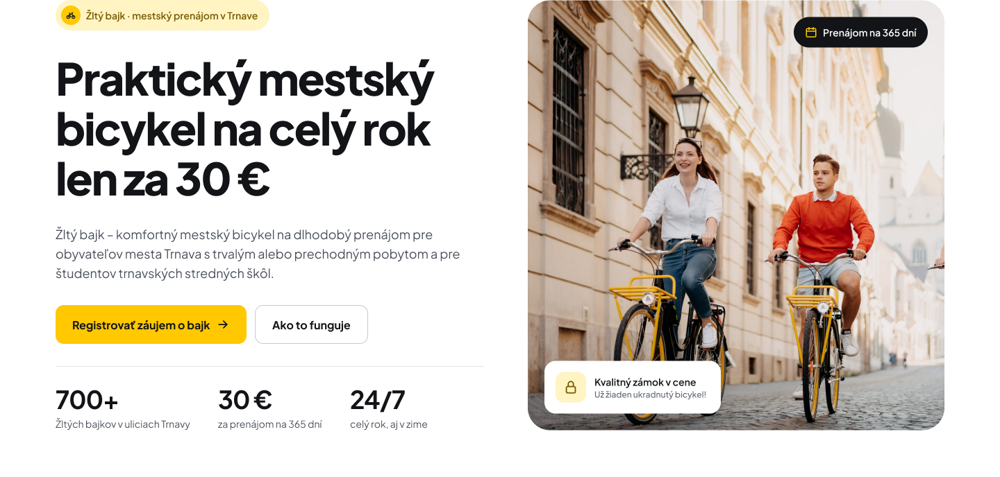
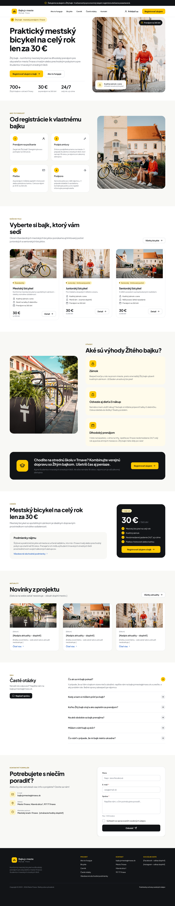
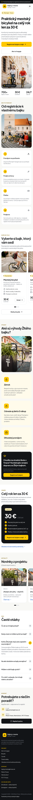
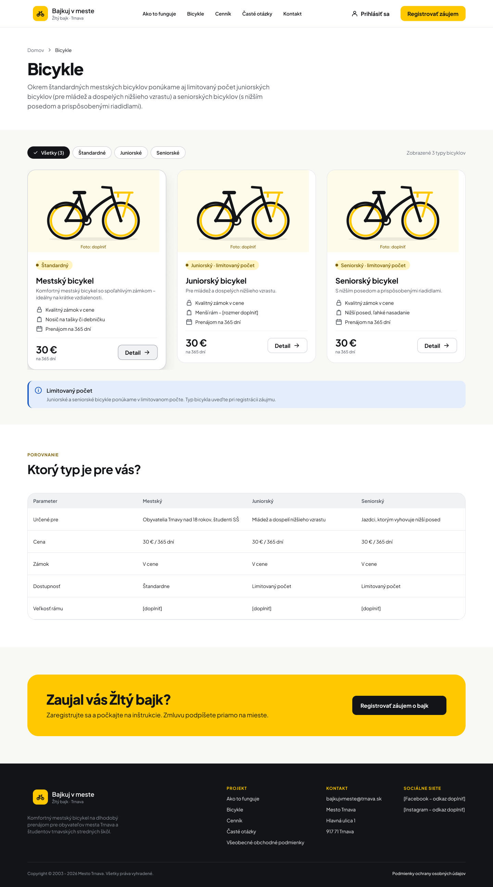
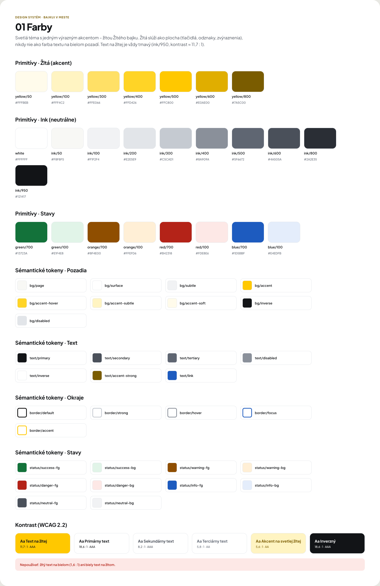

# Design Portfolio

UI design work by Oleksandr Chukhray, made in Figma.

## Bajkuj v meste

University design project: a redesign of the website for a city bike rental service in Trnava, Slovakia. It includes desktop and mobile screens and a design system (colors, typography, spacing, icons, buttons, forms). The website itself is coming later.

- **Role:** all design work done by me
- **Tool:** Figma
- **Photos:** some from the original website, some from [Pexels](https://www.pexels.com/)
- **Figma:** [view the full file](https://www.figma.com/design/a0zwAyEkwQVVAWZEOuJyUT/Bajkuj-v-meste?node-id=3-2)

| Home page (desktop) | Home page (mobile) |
|---|---|
|  |  |

| Bike catalog | Design system: colors |
|---|---|
|  |  |

## Contact

[emchik.sasha@gmail.com](mailto:emchik.sasha@gmail.com) · [GitHub profile](https://github.com/eshxyx)
